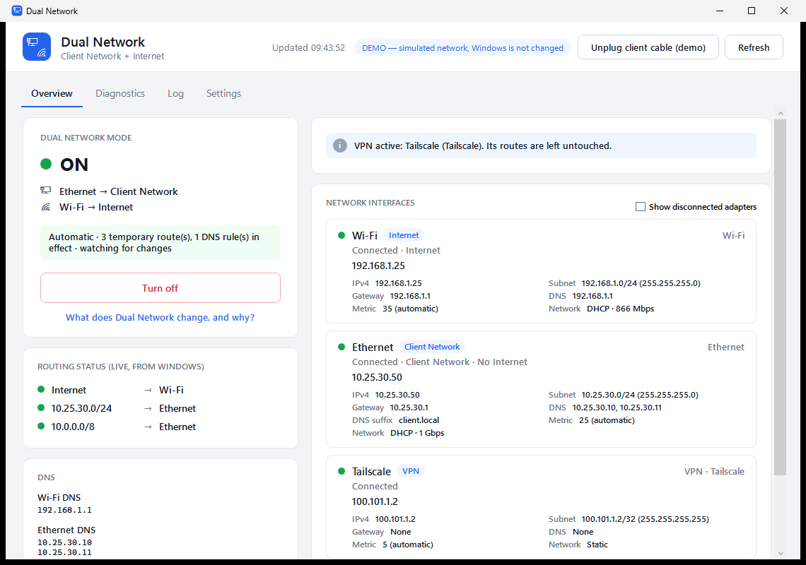
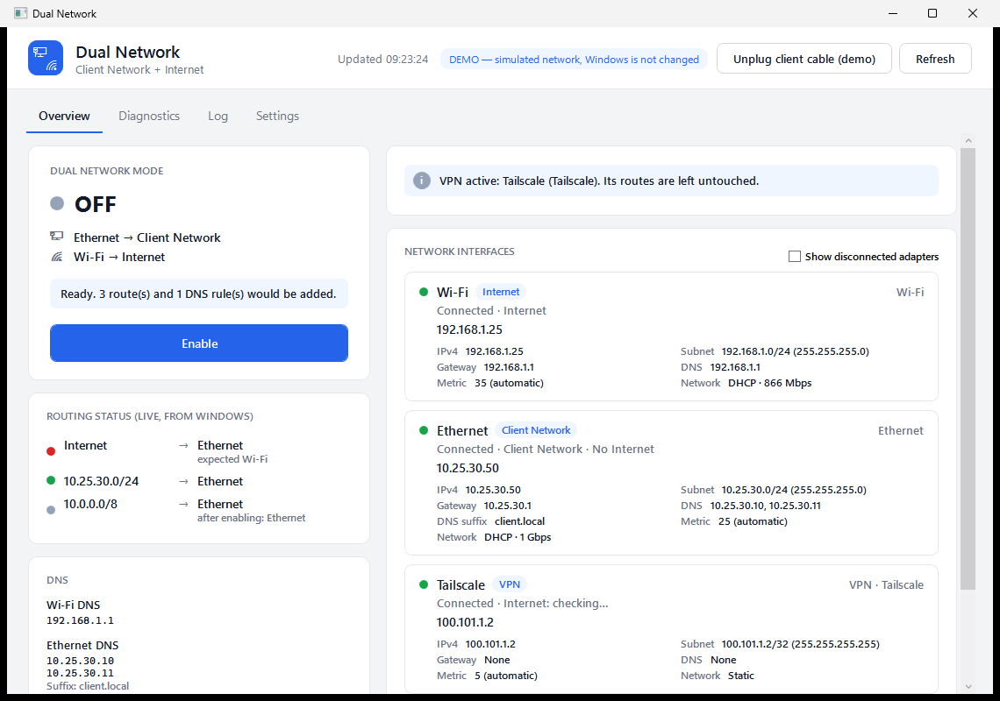
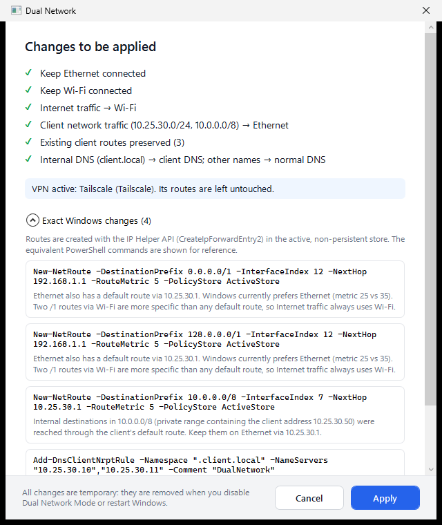
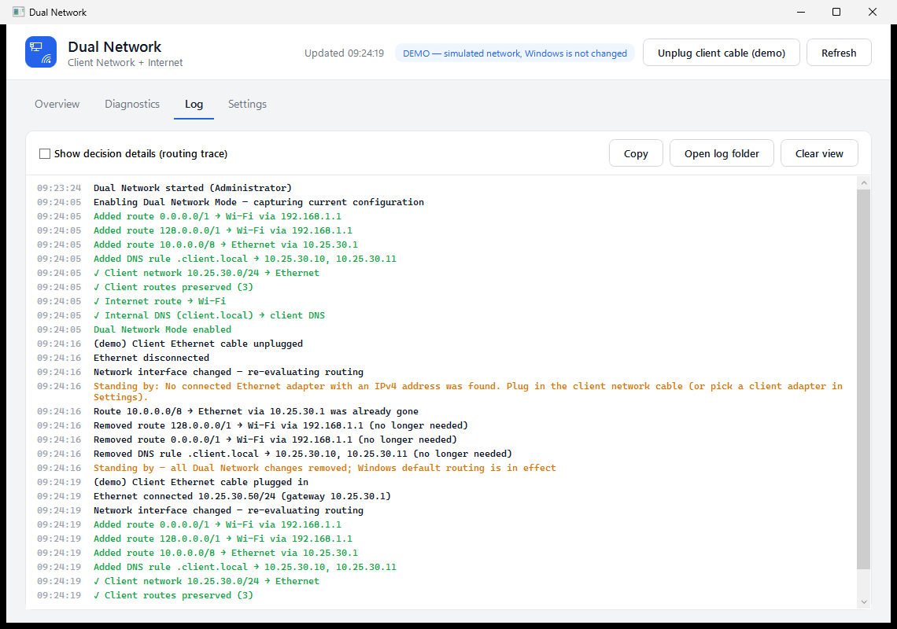
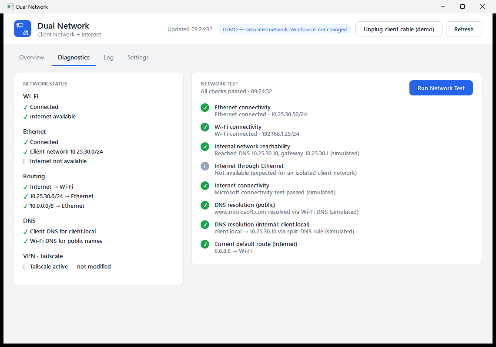
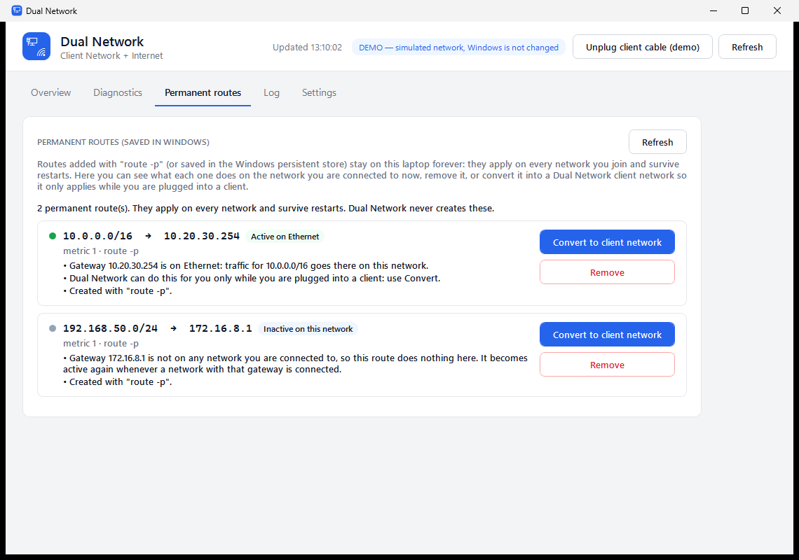

# Dual Network

**Client Network + Internet, at the same time.** A Windows 10/11 utility for consultants and IT/security
staff who plug a laptop into a client's isolated network over **Ethernet** while staying on the
Internet over **Wi-Fi**.

* Ethernet → client/internal network (directly connected subnet, client routes, internal DNS)
* Wi-Fi → public Internet
* No `route add`, no metric tweaking, no adapter disabling. Every change is temporary and reversible.



---

## Why it's needed

Windows picks routes by **longest prefix first**, then **lowest metric**. If the client network hands out a
default gateway, the table holds two `0.0.0.0/0` routes. Wired adapters usually have the lower metric, so
Internet traffic goes to a network that has no Internet:



## How Dual Network fixes it (summary)

The full reasoning, refusal rules and Windows limitations are in **[docs/DESIGN.md](docs/DESIGN.md)**.

1. **Inspect first.** It reads the adapters, the IPv4 routing table, metrics, DNS servers and NRPT rules
   through the IP Helper API, and works out each adapter's real subnet and gateway.
2. **Add, never edit.** Only when the client network has a competing default route, it adds
   `0.0.0.0/1` + `128.0.0.0/1` via the Wi-Fi gateway. These beat any `/0` on prefix length, so Internet
   stays on Wi-Fi regardless of metrics or DHCP renewals. The client's own default route is left in
   place.
3. **Keep the client reachable.** The directly connected subnet always stays on Ethernet, because
   Windows' on-link route is longer. Routes the client supplies (static, DHCP option 121) are preserved.
   When the client has a gateway, **all private networks** (`10.0.0.0/8`, `172.16.0.0/12`, `192.168.0.0/16`)
   and any networks you list are routed to the client gateway. Your own Wi-Fi network stays on Wi-Fi (its
   on-link route is more specific), and DNS servers outside the subnet get `/32` host routes.
4. **Split DNS.** It adds an NRPT rule so the client's DNS suffix (e.g. `*.client.local`) resolves via
   the client DNS servers. Other names keep Windows' normal resolution. Adapter DNS settings are never
   replaced. After applying, it queries the client DNS directly; if no client DNS server can answer for
   the domain, the rule is removed again for that network and Windows' normal DNS is used.
5. **Watch and converge.** It monitors route, interface and address changes, and polls every 30 s.
   Unplugging Ethernet removes everything. Replugging, changing Wi-Fi networks or a DHCP change
   recalculates the routes. If a full-tunnel VPN comes up, Dual Network stands down.
6. **Undo exactly.** Every change is journaled as it happens. Turning off (or exiting) removes exactly what is in the
   journal, then verifies the result against the snapshot taken before the first change. After every change a
   **self-check** asks Windows where traffic really goes and confirms nothing was stored persistently.

Everything above happens **automatically**. You never need to run commands, open PowerShell, or approve
individual changes. The app explains every change it makes (in the log, in the tray notification, and in
*What does Dual Network change, and why?* on the main screen):



## Install and use

Requirements: Windows 10 1809+ or Windows 11. Nothing else; the published exe includes .NET.

1. Download **DualNetwork.exe** from the [latest release](https://github.com/silvermgs24/DualNetwork/releases/latest) and put it somewhere permanent, e.g. `C:\Program Files\Dual Network\`.
2. Run it once and accept the Windows **Administrator** prompt. Changing routes needs admin rights; the
   app asks for them by itself.

That's all. From then on:

| Situation | What Dual Network does by itself |
|---|---|
| You sign in to Windows | Starts in the notification area (tray), elevated, with **no prompt**. It registers a Task Scheduler sign-in task on first run; you can switch this off in Settings. |
| You plug into a client network whose gateway has no Internet | Adds the temporary routes and split-DNS rule, checks with Windows that Internet → Wi-Fi and client network → Ethernet, and shows a notification. |
| The client network has no gateway | Changes nothing (Windows already routes correctly), keeps watching, and handles the DNS rule if needed. |
| Ethernet unplugged, Wi-Fi lost, subnets overlap, or a full-tunnel VPN starts | Removes all of its changes and **stands by** (amber), then steps back in when it's safe. |
| You move to another Wi-Fi, or the client hands out a new address | Recalculates and moves the routes to the new gateway. |
| You close the window | Keeps running in the tray. Left-click the tray icon to reopen it, or start the exe again, which brings the running copy to the front. |
| Exit (tray icon → right-click → Exit) | Removes all of its changes and restores the original configuration. It turns itself back on at the next start. |
| **Turn off** on the main screen | Restores the original configuration and **stays off**, even after a restart, until you click **Turn on**. |
| Crash, forced kill or power loss | Routes vanish at reboot. At the next start, the app adopts or cleans up anything left over by itself. |
| A self-check fails after a change | Shows a red notification, and the log says what Windows actually did. |

The tray icon shows the state at a glance: green dot = on, amber = standing by, grey = off.

### Try it without a client network

```bash
publish\DualNetwork.exe --demo
```

This runs the same app against a **simulated** network: hotel Wi-Fi, and a client network whose gateway has no
Internet and whose DNS servers live in another private subnet. It needs no admin rights and changes nothing in Windows. Use *Unplug client cable
(demo)* to watch it react.

### Build from source

Requires the .NET 8 SDK.

```bash
dotnet build DualNetwork.sln -c Release
```

```bash
dotnet publish src/DualNetwork.App -c Release -r win-x64 --self-contained true -p:PublishSingleFile=true -p:IncludeNativeLibrariesForSelfExtract=true -p:EnableCompressionInSingleFile=true -p:DebugType=none -o publish
```

### Command line (`dualnet.exe`, optional, for IT staff)

The app does everything on its own; the CLI is only for scripting and troubleshooting.

| Command | What it does | Admin |
|---|---|---|
| `dualnet status` | Adapters, roles, where Internet traffic goes now, the plan | no |
| `dualnet plan [--json]` | The plan with exact changes, reasons and the decision trace | no |
| `dualnet test` | The network test | no |
| `dualnet routes` | The IPv4 routing table as read via the IP Helper API | no |
| `dualnet run` | Manage routing until Ctrl+C, then restore (headless alternative to the app) | yes |
| `dualnet restore` | Remove every Dual Network change | yes |
| `dualnet startup on\|off` | Register or remove the sign-in task | yes |
| `dualnet snapshot` | Dump the current configuration as JSON | no |
| `dualnet report` | Save a support report (adapters, routes, DNS rules, plan, network test, log) to the Desktop | no |
| `dualnet permanent` | Permanent routes and what they do on this network | no |
| `dualnet permanent remove <prefix> <nexthop>` (or `restore`) | Remove a permanent route (kept for undo) or restore it | yes |

## The app

| Tab | Contents |
|---|---|
| **Overview** | Dual Network Mode (ON / STANDBY / OFF) with one **Turn on / Turn off** button, live routing status (asked from Windows via `GetBestRoute2`), DNS per adapter, notices, and every adapter with IP, subnet, gateway, metric, DNS, DHCP/static, speed and role (Internet / Client Network / VPN / Virtual). |
| **Diagnostics** | Network status summary, **Run Network Test** and **Save report**. The test covers link state, gateway ping, each client DNS server queried directly (and which adapter Windows uses to reach it), Internet test (`msftconnecttest`), whether Ethernet itself has Internet, public and internal DNS resolution, and the real default route and client route. Advanced mode adds the full routing table, with Dual Network's routes marked ★. |
| **Log** | A timestamped log for troubleshooting, including the self-checks. *Show decision details* adds the planner's step-by-step trace. Also written to `%LOCALAPPDATA%\DualNetwork\logs`. |
| **Permanent routes** | Every route saved permanently in Windows (`route -p`, PersistentStore), and what it does on the current network: active, inactive (gateway not here) or conflicting (e.g. it swallows the Wi-Fi network). **Remove** deletes it from Windows (verified, restorable). **Convert to client network** replaces it with a Dual Network client network, so it applies only while you are plugged into a client. Removed routes can be restored with one click. |
| **Settings** | Start with Windows, notifications, overriding the adapters (e.g. USB tethering), the preferred Internet path when both networks have Internet, client ranges and extra client networks, internal domains, split DNS on/off, and Advanced mode. Saved settings take effect immediately. |




### Permanent routes (`route -p`)

Routes added with `route -p` stay on the laptop forever and apply at **every** site, including where they make no
sense. The **Permanent routes** tab shows each one, says what it does on the network you're on right now, and
lets you remove it (with undo) or convert it into a Dual Network client network, which applies only while you're
plugged into a client. The Overview also mentions when permanent routes exist.



## When it refuses to act

It **stands by**: it makes no changes, or removes the ones it made, when:

* there is no Ethernet with a usable address, or it only has an APIPA (169.254.x.x) address;
* there is no Wi-Fi with a gateway;
* the subnets overlap;
* a full-tunnel VPN owns the default route;
* another tool already installed `/1` routes;
* Wi-Fi has no Internet but Ethernet does.

Individual changes that would conflict with Wi-Fi, a VPN, or an existing route or NRPT rule are skipped
with a warning. Full table: [docs/DESIGN.md §5](docs/DESIGN.md).


## Safety and rollback

| Guarantee | How |
|---|---|
| Nothing permanent | Routes are created with `CreateIpForwardEntry2` in the active (non-persistent) store, so a reboot clears them. NRPT rules are tagged with the comment `DualNetwork` and removed on disable or at the next start. |
| Snapshot before the first change | `%ProgramData%\DualNetwork\snapshots\snapshot-*.json`: routes, metrics, IP config, DNS, NRPT |
| Exact undo | `%ProgramData%\DualNetwork\state.json` journals each change as soon as it succeeds. A route that already existed is never journaled, so it is never removed. |
| Crash or kill | At the next start the journal is detected and the app adopts the leftover changes (when on) or removes them (when off) by itself. `dualnet restore` does the same from a shell. |
| Self-check after every change | `GetBestRoute2` must show Internet → Wi-Fi and the client network → Ethernet, and `Get-NetRoute -PolicyStore PersistentStore` must not contain any route the app created. A failed check is logged and shown as a red notification. |
| Hard limits in the writer | It never creates a `/0`, never touches VPN or loopback adapters, rejects next hops outside the adapter's subnet, verifies each route after creating it, and refuses to remove an NRPT rule without the tag. |
| Never (on its own) | Disable adapters, change interface metrics, replace DNS servers, edit or delete routes it didn't create. Permanent routes are only changed when you click Remove or Convert on the Permanent routes tab, and every removal can be restored. |
| Persistent footprint | Only the Task Scheduler sign-in task "Dual Network" (Settings → Start with Windows) and the app's own files under `%ProgramData%` and `%LOCALAPPDATA%`. |

## Architecture

```text
DualNetwork.sln
├── src/DualNetwork.Core        (net8.0 — no Windows dependencies; all decision logic)
│   ├── Net/IPv4Prefix          prefix maths (contains/overlaps, RFC 1918 blocks)
│   ├── Model/                  AdapterInfo, RouteEntry, NetworkState, AdapterClassifier (VPN/virtual detection)
│   ├── Routing/RouteTable      simulation of Windows route selection (longest prefix → metric)
│   ├── Planning/RoutingPlanner the routing + DNS decision engine (pure function: state + settings → plan)
│   ├── Planning/Reconciler     journal vs plan diff (only ever removes journaled items)
│   └── Control/                DualNetworkController (enable/reconcile/disable/resume), Journal,
│                               snapshots, SnapshotComparer, NetworkChangeDescriber, abstractions
├── src/DualNetwork.Windows     (net8.0-windows — OS integration)
│   ├── Interop/IpHelper        GetIpForwardTable2, Create/DeleteIpForwardEntry2, GetIpInterfaceTable,
│   │                           GetBestRoute2, Notify*Change2 (P/Invoke, explicit row offsets)
│   ├── WindowsNetworkStateProvider + InternetProbe   adapter/route/metric/DNS discovery, per-adapter Internet test
│   ├── WindowsRouteWriter      validated, verified route add/remove
│   ├── NrptManager             split DNS via the DnsClient module (validated, tag-checked)
│   ├── NetworkMonitor          debounced change notifications + periodic check
│   ├── DiagnosticsRunner       "Run Network Test"
│   ├── Storage                 journal/snapshots (%ProgramData%), settings/logs (%LOCALAPPDATA%)
│   └── SimulatedNetwork        in-memory network for --demo
├── src/DualNetwork.App         WPF UI (MVVM), confirmation dialog, demo mode
├── src/DualNetwork.Cli         dualnet.exe
└── tests/DualNetwork.Core.Tests  xUnit tests of the routing decisions and the controller
```

| Requested component | Implementation |
|---|---|
| Network Interface Manager | `WindowsNetworkStateProvider`, `AdapterClassifier`, `InternetProbe` |
| Route Manager | `RoutingPlanner` (decisions), `Reconciler`, `WindowsRouteWriter` (execution) |
| DNS Manager | DNS part of `RoutingPlanner` (host routes, NRPT plan), `NrptManager` |
| Network Monitor | `NetworkMonitor` → `DualNetworkController.ReconcileAsync` |
| Configuration Snapshot / Restore | `Journal`, `ConfigurationSnapshot`, `JsonStateStore`, `SnapshotComparer`, `DualNetworkController.DisableAsync/ResumeAsync` |
| Diagnostics | `DiagnosticsRunner`, `RouteTable` (simulation), `IpHelper.BestRoute` (ground truth) |

The planner is a pure function, and the controller depends only on interfaces. That is why the routing
logic can be tested exhaustively without Windows, and why the same engine drives the GUI, the CLI and
the demo.

## Tests

```bash
dotnet test tests/DualNetwork.Core.Tests
```

103 tests cover:

* the two core cases from the spec (Ethernet with and without a gateway);
* client ranges derived from the actual address rather than hard-coded;
* preserving client routes;
* refusals: overlap, APIPA, missing adapters, full-tunnel VPN (both `/0` and the OpenVPN `/1` style), foreign `/1` routes, Ethernet-only Internet;
* split-tunnel VPN conflicts;
* both networks having Internet, with either preference;
* DNS reachability: host routes for client DNS and pinning Wi-Fi DNS;
* NRPT planning and conflicts;
* stable re-planning when our own routes are present;
* manual role overrides (USB tethering);
* the controller: snapshot → apply → journal, exact restore verified against the snapshot, rollback when a step fails, never taking over pre-existing routes, Ethernet unplug/replug, Wi-Fi roaming, a VPN starting, Windows dropping a route, no-op reconciles, crash recovery and resume, and cleaning up orphaned rules;
* the first real site visit: a Wi-Fi hotspot inside 10.0.0.0/8, client DNS and servers in other 10.x subnets, and a VPN route overlapping 10.0.0.0/8 (the client network now wins for its own ranges, and the client DNS servers are always routed to the client network);
* all private ranges by default: home Wi-Fi in 192.168.x and phone hotspots in 172.20.10.x stay on Wi-Fi, a Wi-Fi network spanning a whole private range is left alone, and Wi-Fi DNS inside another private range is pinned to Wi-Fi;
* split DNS that switches itself off when the client DNS cannot be used, and is tried again on the next network;
* automatic mode: activation without a client network (stand by, then apply when the cable is plugged in, with the snapshot taken right before the first change), idempotence, failed self-checks, and the admin requirement;
* permanent routes: parsing the `route -p` store, merging both stores, and explaining active, inactive and conflicting routes;
* prefix maths, adapter classification, route selection and snapshot diffs.

## Verification status

| Area | Status |
|---|---|
| Decision engine, controller, automatic mode | ✅ 103 unit tests passing, including a reproduction of the first site visit (hotspot in 10.x, client DNS in another 10.x subnet) |
| Reading adapters, routes and metrics via the IP Helper API | ✅ Verified live: the struct offsets match `Get-NetRoute` and `Get-NetIPInterface` exactly |
| `GetBestRoute2`, Internet probe, ping/DNS/HTTP diagnostics, NRPT listing, persistent-store query | ✅ Verified live, non-elevated |
| Automatic flow: turns on at launch → applies → self-check → unplug/replug → Turn off/on; close-to-tray; second launch brings the window back | ✅ Verified in `--demo` (UI Automation + screenshots) |
| Sign-in task definition | ✅ Same XML registered at standard privilege under a test name, read back, then deleted. The real (highest-privilege) registration happens when the elevated app first runs. |
| Self-contained single-file exe | ✅ Published and launched |
| Permanent routes tab: list, analysis, Remove, Restore, Convert | ✅ Verified in `--demo` (UI Automation + screenshots). Reading both real stores verified live, non-elevated. ⚠️ Real removal and restore (route.exe + Remove-NetRoute, verified by reading back) not yet run elevated. |
| Creating and deleting routes and NRPT rules on a real system, elevated | ⚠️ **Not yet run**: the development VM has no Wi-Fi and this session could not accept a UAC prompt. The app now checks this itself after every change (self-check above), so the first real run reports in the log whether Windows routes as planned. |
